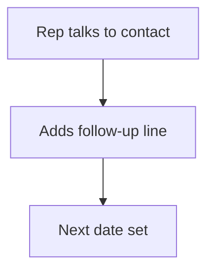

# Follow-up log on a record

## Task

Log dated follow-ups or remarks against a lead or other record.

## How

- Grid of date and remarks on the record, or a follow-up sheet with refTarget to any row.
- Formula copies the target name.

## Workaround

No. Direct feature (grid or refTarget).

## Limits

- Grid logs are not reportable across records as easily as a sheet.

## Flowchart

## Execute

Only use this to apply this into a Studio Enterprise via MCP.

Placeholders: FollowUps, FollowUpForm, FollowUpSheet. Needs first: the record form (grid variant) or target sheets (sheet variant).

1. Grid variant: on record form `add kind=composite type=grid name=FollowUps` → fields `type=date FollowUpDate`, `type=paragraph Remarks`, `type=date NextDate` → `kind=gridLayout kind=table composite=FollowUps showComps=[…]`.
2. Sheet variant: `add kind=form FollowUpForm` → `type=section` → `type=refTarget refTargetSpreadsheetMap` (verify: describe) + date, paragraph, `type=text TargetName disabled=true`.
3. `formFormula assignToField=TargetName formula{value:"${f:…}"}` (verify: describe).
4. `add kind=spreadsheet name=FollowUpSheet form=FollowUpForm` → `kind=spreadsheetLayout kind=table`.
5. `kind=action kind=rowInsert` + `kind=spreadsheetEditor` → `set kind=group actionPermissionMap`.
6. `validate` till ok=true.

Gaps: refTargetSpreadsheetMap shape; how a formula reads the refTarget row name.
