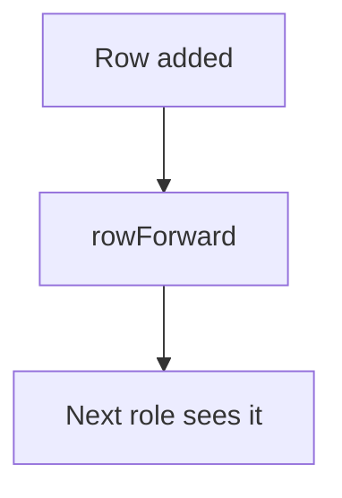

# Forward a row to another role

## Task

Pass a new row on to the next role or sheet (request lines to the store, order onward, summary trigger).

## How

- rowForward node after insert.
- Row update after forward.

## Workaround

No. Direct feature (rowForward).

## Limits

- Forward targets are fixed in the flow.

## Flowchart

