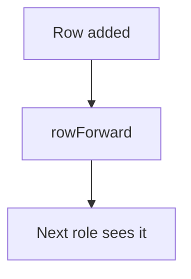

# Forward a row to another role

## Task

Pass a new row on to the next role or sheet (request lines to the store, order onward, summary trigger).

## How

- rowForward node after insert.
- Row update after forward.

## Workaround

No. Direct feature (rowForward).

## Limits

- Forward targets are fixed in the flow.

## Flowchart

## Execute

Only use this to apply this into a Studio Enterprise via MCP.

Placeholders: Sheet, ForwardWf, ToGroup. Needs first: Sheet, target group or role.

1. Manual forward too (optional): `set kind=spreadsheet userForwardRolePermissionMap` / `groupForwardRolePermissionMap`.
2. Workflow: `add kind=workflow name=ForwardWf` (4 maps `{}`).
3. Nodes: `kind=eventSsInsertAfter spreadsheet=Sheet` → `kind=rowForward rowIdPointer{spreadsheet:Sheet, row:<$Curr row binder>} toGroups=[ToGroup]` or `toUsers` → `kind=rowUpdate rowIdPointer option=Mapping outputMapping` (forwarded status).
4. `set kind=workflow edgeMap`: NEXT chain.
5. `validate` till ok=true.

Gaps: rowIdPointer row binder for $Curr (run `schema kind=argBinder`); edgeMap entry keys unverified.
