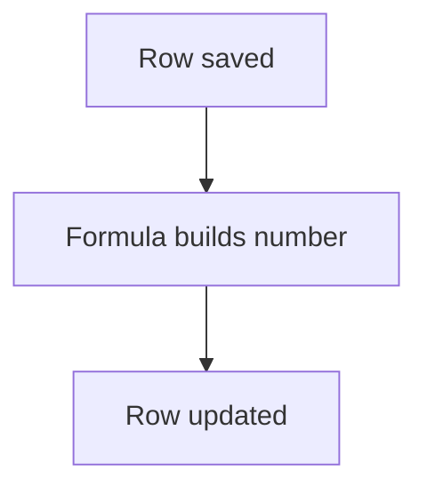

# Readable ID made after insert

## Task

Give each row a readable number (payment, order, quotation, request) and set derived codes.

## How

- identifier field for the sequence.
- Workflow on insert-after: applyFormula builds the number, rowUpdate writes it.

## Workaround

No. Direct feature (identifier field and formula).

## Limits

- Number appears only after save.

## Flowchart

## Execute

Only use this to apply this into a Studio Enterprise via MCP.

Placeholders: OrderSeq, OrderNo, Sheet, IdWf. Needs first: Sheet.

1. Var: `add kind=var kind=sequence name=OrderSeq deploy=fixedOnDeploy value={value:1}`.
2. Field: `type=identifier name=OrderNo textPattern{arg, argBinderMap} setOnSend=true` (verify: describe).
3. Derived codes: `type=text disabled=true` fields.
4. Workflow: `add kind=workflow name=IdWf` → `kind=eventSsInsertAfter spreadsheet=Sheet` → `kind=applyFormula assignToField{param:$Curr, field:OrderNo} javascriptFormula{value}` → `kind=rowUpdate rowIdPointer{spreadsheet:Sheet, row} option=Mapping`.
5. `set kind=workflow edgeMap`: NEXT chain.
6. `validate` till ok=true.

Gaps: how the sequence var feeds the identifier textPattern unverified; sequence has no prefix/format, build it in the formula.
