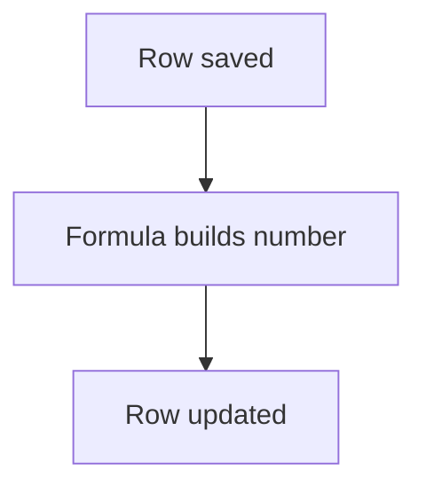

# Readable ID made after insert

## Task

Give each row a readable number (payment, order, quotation, request) and set derived codes.

## How

- identifier field for the sequence.
- Workflow on insert-after: applyFormula builds the number, rowUpdate writes it.

## Workaround

No. Direct feature (identifier field and formula).

## Limits

- Number appears only after save.

## Flowchart

