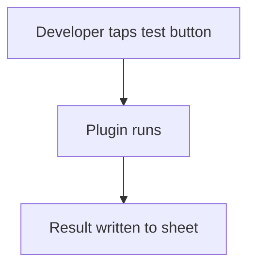

# Helper sheet for tests and logs

## Task

Developer or support tries outside calls, keeps a debug log, or fixes live rows.

## How

- Sheet with text fields and buttons that call plugins; results written back.
- Log sheet filled by workflows with event name and key fields.
- spreadsheetEditor actions on live sheets for Support and Developer roles only.

## Workaround

Yes. No API test screen, debug log view or data fix tool; role-limited sheets stand in.

## Limits

- Keep these roles small; edits skip normal checks.

## Flowchart

## Execute

Only use this to apply this into a Studio Enterprise via MCP.

Placeholders: Support, Developer, ApiTestSheet, DebugLogSheet. Needs first: the plugin (import only).

1. Roles: `add kind=role name=Support`, `add kind=role name=Developer`.
2. Test form: `add kind=form ApiTestForm` → `type=section` → `type=text` inputs, `type=paragraph Result`, `type=button buttonKind=normal targetType=invokePlugin pluginApi.metaIdPlugin pluginInputMapping pluginOutputMapping` → `kind=spreadsheet ApiTestSheet` → `spreadsheetLayout kind=table`.
3. Log form: `DebugLogForm` → `type=text EventName`, `type=paragraph KeyValues`, `type=dateTime LoggedAt` → `DebugLogSheet` → `spreadsheetLayout kind=table`.
4. Logging: in each workflow, `kind=paramUpdate option=Mapping` → `kind=rowInsert spreadsheet=DebugLogSheet` (apply PAT-insert-row-in-other-sheet Execute).
5. Fix tool: `kind=action kind=spreadsheetEditor spreadsheet=<LiveSheet> layoutSpreadsheet=<table>` per live sheet + both helper sheets → `set kind=group actionPermissionMap` roles [Support, Developer] only.
6. `validate` till ok=true.

Gaps: plugin create is import only; button plugin mapping shapes unverified (describe).
