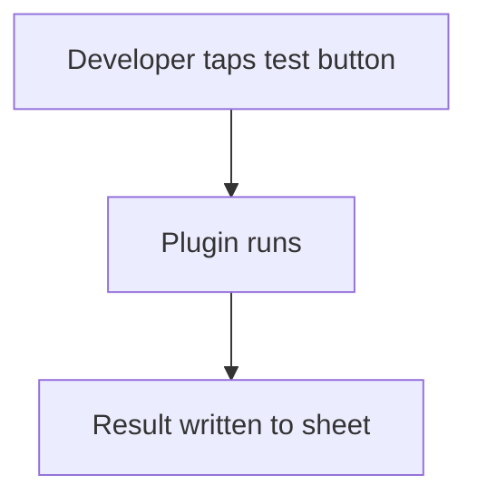

# Helper sheet for tests and logs

## Task

Developer or support tries outside calls, keeps a debug log, or fixes live rows.

## How

- Sheet with text fields and buttons that call plugins; results written back.
- Log sheet filled by workflows with event name and key fields.
- spreadsheetEditor actions on live sheets for Support and Developer roles only.

## Workaround

Yes. No API test screen, debug log view or data fix tool; role-limited sheets stand in.

## Limits

- Keep these roles small; edits skip normal checks.

## Flowchart

