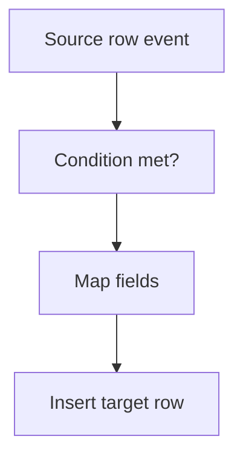

# Insert a row in another sheet on event

## Task

An event on one row makes a row elsewhere (approved request makes a customer, follow-up date makes a planned visit, received lot makes unit rows).

## How

- Workflow on insert-after or on a field change.
- Branch on the condition (approved, date has value, flag true).
- paramUpdate to map fields, then rowInsert into the target sheet.
- Copy variant: insert a copy for a second user on the same sheet.

## Workaround

No. Direct feature (rowInsert node). The copy-for-a-colleague variant stands in for shared rows.

## Limits

- No link back unless the new rowId is written to the source row.

## Flowchart

