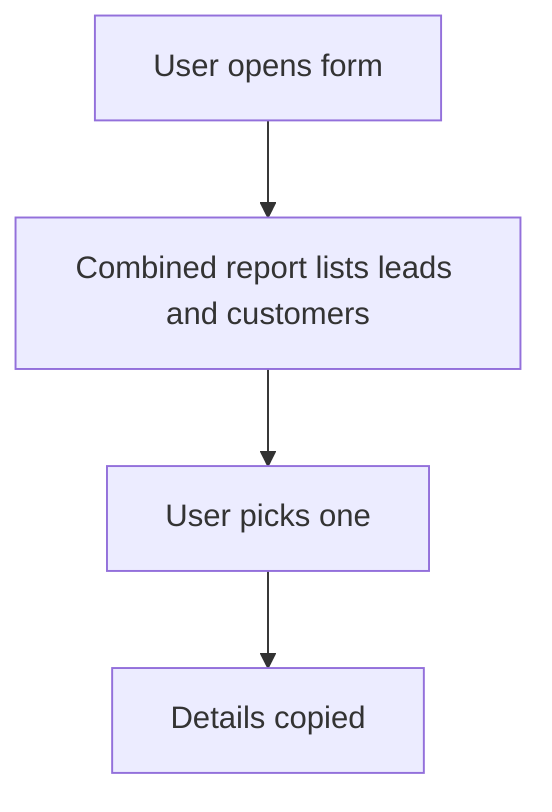

# Pick a lead or a customer from one list

## Task

Pick a target that may be a lead or an existing customer (or a visit) from one list.

## How

- Query report that returns lead and customer rows together.
- refReport field with copied name, category and contact.
- Optional type pickText (lead or current customer) to pick the source.

## Workaround

Yes. Lead and customer are two sheets; a combined report stands in for one list.

## Limits

- Copied data does not follow when a lead becomes a customer.
- Every form that needs it repeats the report ref.

## Flowchart

## Execute

Only use this to apply this into a Studio Enterprise via MCP.

Placeholders: TargetType, TargetPickOut, TargetPickReport. Needs first: lead sheet, customer sheet.

1. Var (optional): `add kind=var kind=setOfText name=TargetType deploy=fixedOnDeploy value={Lead:{}, Customer:{}}`.
2. Output form `TargetPickOut` → `type=grid name=Targets` + `type=text` Name, Category, Contact, Source → `kind=gridLayout kind=table name=TargetsTable showComps=[…]`.
3. Report: `add kind=report kind=query outputForm=TargetPickOut fromSpreadsheets=[LeadSheet, CustomerSheet] neoQL{value}` (lead and customer rows joined); `inputForm` if it filters by TargetType.
4. On each user form: `type=pickText source=TargetType` (optional) → `type=refReport report=TargetPickReport grid=Targets layoutGrid=TargetsTable copyFieldMap keyFields` → target fields Name, Category, Contact.
5. `validate` till ok=true.

Gaps: copyFieldMap shape (describe); how the report reads the TargetType input; NeoQL text written by hand.
