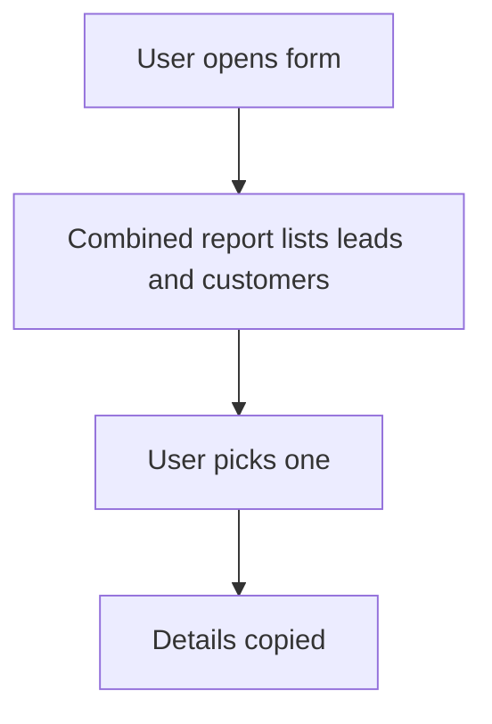

# Pick a lead or a customer from one list

## Task

Pick a target that may be a lead or an existing customer (or a visit) from one list.

## How

- Query report that returns lead and customer rows together.
- refReport field with copied name, category and contact.
- Optional type pickText (lead or current customer) to pick the source.

## Workaround

Yes. Lead and customer are two sheets; a combined report stands in for one list.

## Limits

- Copied data does not follow when a lead becomes a customer.
- Every form that needs it repeats the report ref.

## Flowchart

