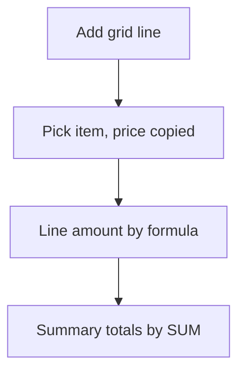

# Line items grid with totals

## Task

List items (products, parts, expenses, materials) on one row and total them with discount and tax.

## How

- Grid section; each line refs the product or item master and copies price, unit and tax.
- Formula per line: amount = quantity x rate, tax, discount.
- Summary formulas: SUM over the grid, grand total, amount in words.
- onInitAndOnChange events keep totals live.

## Workaround

No. Direct feature (grid plus formula logic).

## Limits

- Formulas run on the form; values written later by workflows need their own recalculation.
- Tax rules are hand-written in formulas.

## Flowchart

