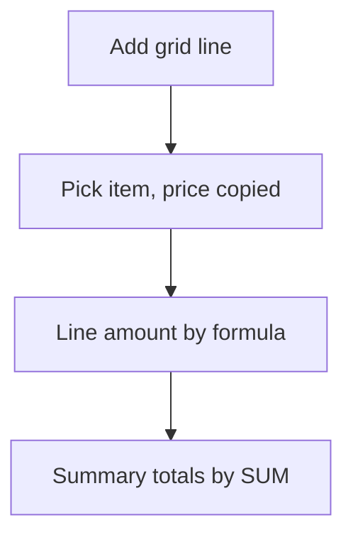

# Line items grid with totals

## Task

List items (products, parts, expenses, materials) on one row and total them with discount and tax.

## How

- Grid section; each line refs the product or item master and copies price, unit and tax.
- Formula per line: amount = quantity x rate, tax, discount.
- Summary formulas: SUM over the grid, grand total, amount in words.
- onInitAndOnChange events keep totals live.

## Workaround

No. Direct feature (grid plus formula logic).

## Limits

- Formulas run on the form; values written later by workflows need their own recalculation.
- Tax rules are hand-written in formulas.

## Flowchart

## Execute

Only use this to apply this into a Studio Enterprise via MCP.

Placeholders: Doc (host form), Lines, ItemSheet, ItemList. Needs first: host form Doc; item master sheet with a list or card layout.

1. Grid: `add kind=composite parent=Doc type=grid name=Lines` → `type=ref Item spreadsheet=ItemSheet layoutSpreadsheet=ItemList copyFieldMap` → `type=decimal` Rate, TaxPct, Discount; `type=text Unit`; `type=number Qty`; `type=decimal` Amount, LineTax (`disabled=true`).
2. Summary: `add kind=composite parent=Doc type=section name=Summary` → `type=decimal` SubTotal, TaxTotal, GrandTotal; `type=text AmountInWords` (all `disabled=true`).
3. `kind=gridLayout kind=table composite=Lines showComps=[…]`.
4. Line formulas: `formFormula assignToField=Lines.Amount formula{value:"${f:Lines.Qty}*${f:Lines.Rate}-${f:Lines.Discount}"}`; same for `Lines.LineTax`.
5. Totals: `formFormula assignToField=SubTotal formula{value:"SUM(${f:Lines.Amount})"}`; TaxTotal, GrandTotal; AmountInWords (JS, or `var kind=function`).
6. Live: form `calculateFormulaMode=automatic`, or `formEventAction kind=executeFormula` + `formEvent kind=onInitAndOnChange eventComps=[Lines.Qty, Lines.Rate, Lines.Discount]`.
7. `validate` till ok=true.

Gaps: copyFieldMap shape (describe); amount-in-words JS by hand; values written by workflows need own recalculation.
