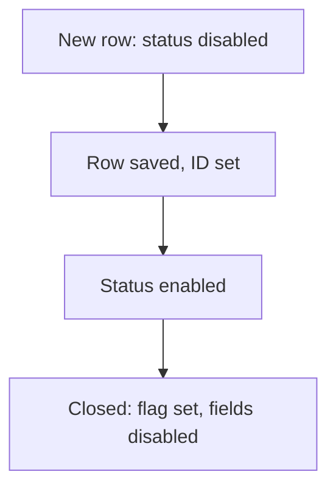

# Lock fields until saved or closed

## Task

Status or other fields cannot be changed until the row is saved, or after it is closed.

## How

- Visibility rule that disables the field when the row ID (or linked user) has no value.
- Bool flag set on close; a rule disables all fields when the flag is true.
- onInitAndOnChange event.

## Workaround

Yes. No read-only-until-saved or lock feature; visibility rules and bool flags stand in.

## Limits

- Role rights still allow edits from other actions; the rule only guards the form.
- The flag must be set by a workflow or formula.

## Flowchart

