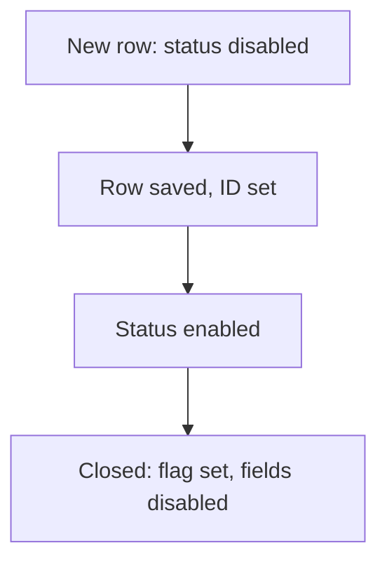

# Lock fields until saved or closed

## Task

Status or other fields cannot be changed until the row is saved, or after it is closed.

## How

- Visibility rule that disables the field when the row ID (or linked user) has no value.
- Bool flag set on close; a rule disables all fields when the flag is true.
- onInitAndOnChange event.

## Workaround

Yes. No read-only-until-saved or lock feature; visibility rules and bool flags stand in.

## Limits

- Role rights still allow edits from other actions; the rule only guards the form.
- The flag must be set by a workflow or formula.

## Flowchart

## Execute

Only use this to apply this into a Studio Enterprise via MCP.

Placeholders: RowRef, IsClosed, Status. Needs first: the form.

1. Fields: `type=rowId name=RowRef`, `type=bool name=IsClosed defaultValue=false`.
2. Conditions: `formEventCondition name=NotSaved statement{lhs:RowRef, operator:hasNoValue}`; `name=Closed statement{lhs:IsClosed, operator:equalTo, rhs:<constant bool>}`.
3. Actions: `formEventAction name=LockStatus kind=disable comps=[Status]`; `UnlockStatus kind=enable comps=[Status]`; `LockAll kind=disable comps=[…all fields]`.
4. Event: `formEvent kind=onInitAndOnChange eventComps=[RowRef, IsClosed] actions=[{action:LockStatus,condition:NotSaved},{action:UnlockStatus,condition:NotSaved,negate:true},{action:LockAll,condition:Closed}]`.
5. Set IsClosed on close: workflow `kind=rowUpdate`, or `formFormula assignToField=IsClosed`.
6. `validate` till ok=true.

Gaps: bool constant rhs shape (`schema kind=argBinder`); rowId value before save unverified; rule guards the form only, not other actions.
