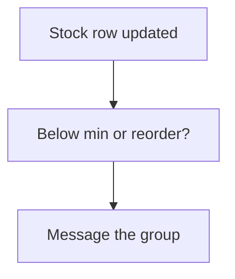

# Low stock alert

## Task

Tell a group when stock goes under a reorder or minimum level, or above a maximum.

## How

- Min, max, reorder or safety stock fields on the item.
- Workflow on update-after of the stock row; branch on quantity against the levels.
- sendMessageToGroups per level.
- Plain variant: a spreadsheet action listing items near the minimum.

## Workaround

No. Direct workflow and message nodes. The list-only variant is a stand-in for an alert.

## Limits

- Fires on every stock update under the level; no once-only guard unless built.

## Flowchart

