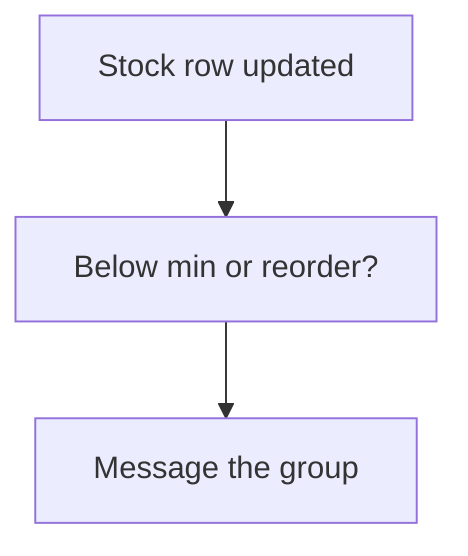

# Low stock alert

## Task

Tell a group when stock goes under a reorder or minimum level, or above a maximum.

## How

- Min, max, reorder or safety stock fields on the item.
- Workflow on update-after of the stock row; branch on quantity against the levels.
- sendMessageToGroups per level.
- Plain variant: a spreadsheet action listing items near the minimum.

## Workaround

No. Direct workflow and message nodes. The list-only variant is a stand-in for an alert.

## Limits

- Fires on every stock update under the level; no once-only guard unless built.

## Flowchart

## Execute

Only use this to apply this into a Studio Enterprise via MCP.

Placeholders: StockSheet, StoreGroup, StockAlertWf. Needs first: item or stock sheet, group.

1. Fields: `type=decimal` Qty, MinLevel, ReorderLevel, MaxLevel. Add Qty to sheet `queryables`.
2. Workflow: `add kind=workflow name=StockAlertWf` (4 maps `{}`).
3. Nodes: `kind=eventSsUpdateAfter spreadsheet=StockSheet` → `kind=branchIfElse option=Condition condition{statement{lhs:Qty, operator:lessThan, rhs:<field binder MinLevel>}}` → TRUE: `kind=sendMessageToGroups message{value:"${Item} low: ${Qty}", paramSet} toGroups=[StoreGroup]`; FALSE: next branchIfElse (ReorderLevel, then `greaterThan` MaxLevel).
4. `set kind=workflow edgeMap`: NEXT, TRUE/FALSE per branch.
5. List variant: `var kind=condition` (Qty lessThanOrEqualTo MinLevel, sourceForm) → `action kind=spreadsheetEditor spreadsheet=StockSheet layoutSpreadsheet=<table> readOnly=true filterCondition{cond}` → `set kind=group actionPermissionMap`.
6. `validate` till ok=true.

Gaps: field rhs binder shape; message param binding to row fields unverified; once-only guard (hasChanged or a bool flag) not built.
