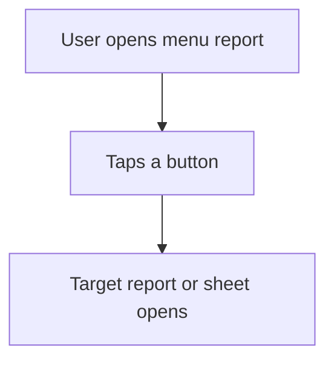

# Menu by button form

## Task

User picks one of many reports or master sheets from one screen.

## How

- Report whose output form holds one button per target.
- Each button opens a report or sheet action.
- One report action opens the menu per role.

## Workaround

Yes. No grouped menu of reports or masters; a form of buttons stands in.

## Limits

- New reports need a new button by hand.
- Buttons do not hide by role; make one menu per role.

## Flowchart

## Execute

Only use this to apply this into a Studio Enterprise via MCP.

Placeholders: MenuForm, MenuLayout, MenuReport, MenuAction. Needs first: target report and sheet actions.

1. Form: `add kind=form MenuForm` → `type=section` → one `type=button buttonKind=normal targetType=triggerAction action=<TargetAction>` per target (pairing: verify: describe).
2. Layout: `kind=formLayout type=content rootLayout=true name=MenuLayout`, buttons in `flexCenter.fields`.
3. Report: `add kind=report outputForm=MenuForm` (kind: verify: describe on an existing menu report).
4. Action: `add kind=action kind=report report=MenuReport outputFormContentLayout=MenuLayout`; one per role.
5. `set kind=group actionPermissionMap`: MenuAction + target actions, roles on each.
6. `validate` till ok=true.

Gaps: report kind for a static button form unclear; button triggerAction pairing inferred; buttons do not hide by role.
