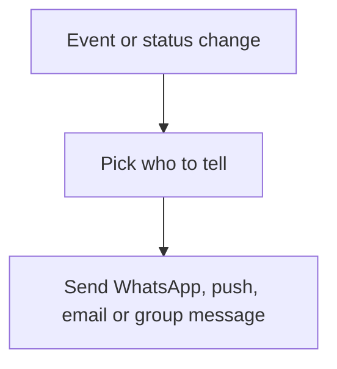

# Message on event

## Task

Tell the customer, vendor, creator, a role or a group when something happens (assigned, approved, paid, new ticket, comment).

## How

- Workflow branch on the event or status.
- sendWhatsappMessage or sendWhatsappTemplate to a mobile field copied from a ref.
- sendMessageToUsers to the creator, a pickUser field or a set of roles; sendPushNotification; sendMessageToGroups; sendEmail.
- Row comment event for comment alerts.

## Workaround

No. Direct feature (message nodes).

## Limits

- Mobile and email must be copied onto the row first.
- WhatsApp templates need approval; free text only inside the reply window.

## Flowchart

