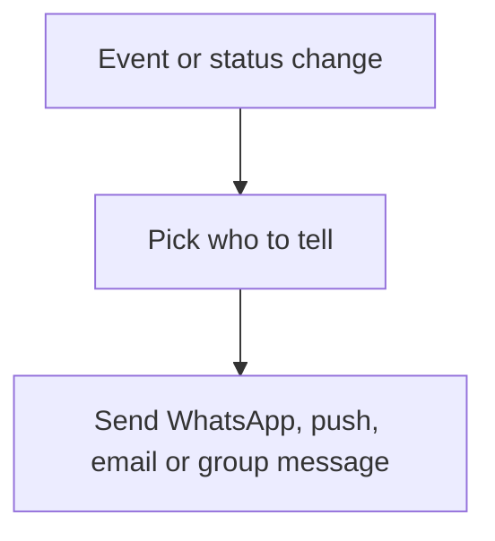

# Message on event

## Task

Tell the customer, vendor, creator, a role or a group when something happens (assigned, approved, paid, new ticket, comment).

## How

- Workflow branch on the event or status.
- sendWhatsappMessage or sendWhatsappTemplate to a mobile field copied from a ref.
- sendMessageToUsers to the creator, a pickUser field or a set of roles; sendPushNotification; sendMessageToGroups; sendEmail.
- Row comment event for comment alerts.

## Workaround

No. Direct feature (message nodes).

## Limits

- Mobile and email must be copied onto the row first.
- WhatsApp templates need approval; free text only inside the reply window.

## Flowchart

## Execute

Only use this to apply this into a Studio Enterprise via MCP.

Placeholders: Sheet, MsgWf, Status. Needs first: Sheet; mobile or email copied onto the row (`ref copyFieldMap`).

1. Fields: `type=mobileNumber` / `type=email` copied from the ref; `type=pickUser` if a named person.
2. Workflow: `add kind=workflow name=MsgWf` (4 maps `{}`).
3. Event: `kind=eventSsInsertAfter|eventSsUpdateAfter spreadsheet=Sheet`, or `kind=eventRowComment` for comments.
4. Branch: `kind=branchSwitchCase field{param:$Curr, field:Status}` or `kind=branchIfElse option=Condition`.
5. Message node per case: `kind=sendWhatsappTemplate toUsers templateGroup templateVarMap` / `kind=sendWhatsappMessage toUsers message`; `kind=sendMessageToUsers message{value,paramSet} toUsers`; `kind=sendMessageToGroups toGroups`; `kind=sendPushNotification`; `kind=sendEmail subject message toUsers`.
6. `set kind=workflow edgeMap`: switch VALUE `value=<option key>`, NEXT = Default; ERROR edge from message nodes if needed.
7. `validate` till ok=true.

Gaps: toUsers (U) binder from a mobile field of a non-member unverified; WhatsApp template approval is outside MCP.
