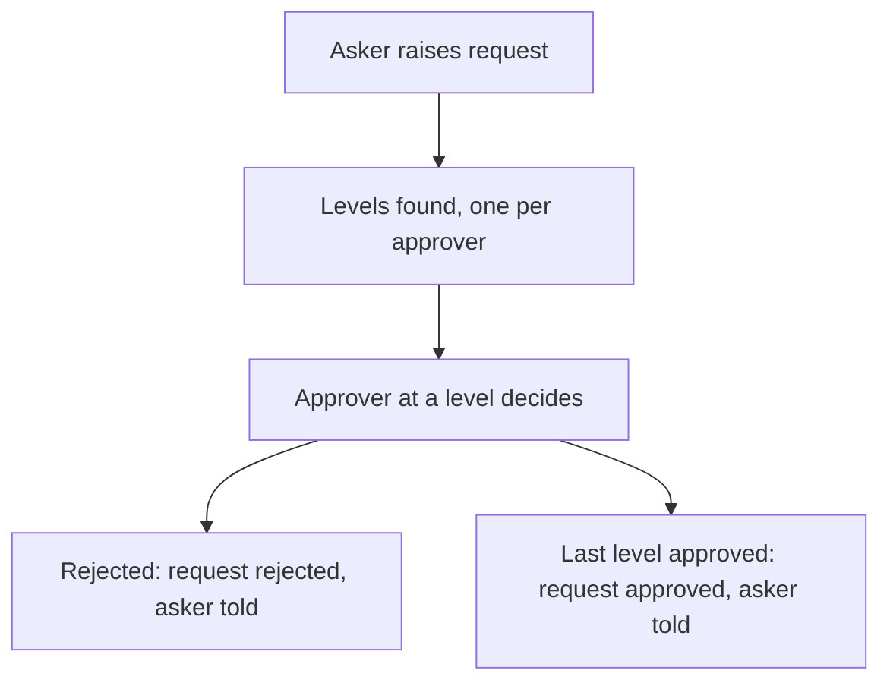

# Multi-level approval by status

## Task

A request passes through two or more approvers in order (for example manager then HR, or levels from a matrix); a rejection at any level ends it; the last level closes it.

## How

- Fixed levels: one status pickText per level on the sheet (manager status, HR status); workflow on update-after branches on the first status, then a nested branch on the next; effects run on the last Approved.
- Matrix levels: matrix sheet of department, level sequence and approver. On request insert, query the matrix, iterate the rows and rowInsert one log row per level (with a LastApprover flag); rowForward sends the request to the approvers.
- Approver sets the log row status. Workflow on log update-after: Rejected sets the request Rejected; Approved on the last level sets it Approved.
- Message to the asker at each decision.

## Workaround

Yes. No multi-level approval step; status lists, a log sheet per level and branches stand in.

## Limits

- Order of levels is not enforced by the sheet; rights and branches keep it.
- Fixed levels need one more status field and branch per extra level.
- Matrix levels need the matrix kept up to date per department.

## Flowchart

