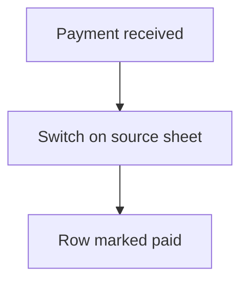

# Online payment event

## Task

When an online payment comes in, mark the matching row (onboarding, job, payment) paid.

## How

- eventPaymentReceipt workflow.
- Switch on which sheet the payment belongs to.
- rowUpdate on that sheet.

## Workaround

No. Direct feature (payment receipt event).

## Limits

- Payment link must carry enough to find the row.

## Flowchart

