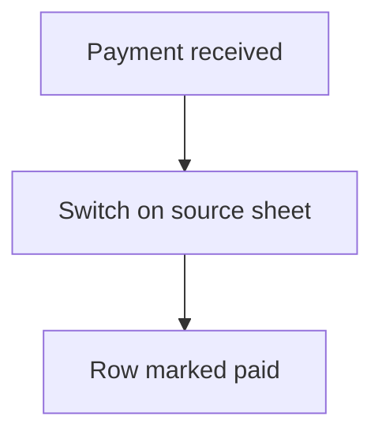

# Online payment event

## Task

When an online payment comes in, mark the matching row (onboarding, job, payment) paid.

## How

- eventPaymentReceipt workflow.
- Switch on which sheet the payment belongs to.
- rowUpdate on that sheet.

## Workaround

No. Direct feature (payment receipt event).

## Limits

- Payment link must carry enough to find the row.

## Flowchart

## Execute

Only use this to apply this into a Studio Enterprise via MCP.

Placeholders: PayWf, <Sheet>, PayStatus. Needs first: paid sheets; payment link or form payment set up.

1. Fields on each paid sheet: `type=paymentStatus PayStatus`, `type=text PayRef`.
2. Link source: form `payment{enablePaymentV2, amountField, referenceIdField}` (`schema kind=formPayment`), or node `kind=generatePaymentLink referenceIdField spreadsheetRowIdField`.
3. Workflow: `add kind=workflow name=PayWf` → `kind=eventPaymentReceipt` → `kind=branchSwitchCase field` on the sheet key (verify: describe) → per sheet `kind=rowUpdate rowIdPointer{spreadsheet:<Sheet>, row} option=Mapping outputMapping` (PayStatus=paid).
4. `set kind=workflow edgeMap`: VALUE per sheet, NEXT = Default.
5. `validate` till ok=true.

Gaps: eventPaymentReceipt payload fields unknown (describe an existing one); switch needs a pickText field, else use a branchIfElse chain.
