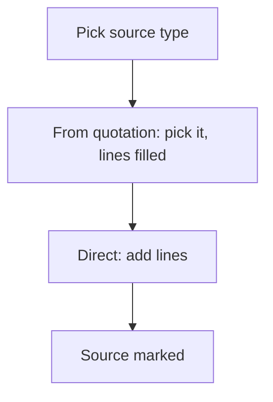

# Order from a quotation or direct

## Task

An order starts from a quotation (or visit, enquiry, lead) or is typed in directly; the source is marked.

## How

- Source pickText (quotation or direct) on the order.
- Ref to the source row; visibility shows the right fields.
- Lines filled from the source by a report ref.
- Workflow on insert-after updates the source (order created flag or status).

## Workaround

No. Direct feature (pickText, ref, branch). The order-created Yes or No flag on the quotation stands in for a link status.

## Limits

- Changes to the quotation after the order do not flow to the order.

## Flowchart

## Execute

Only use this to apply this into a Studio Enterprise via MCP.

Placeholders: OrderSource, OrderSheet, QuoteSheet, QuoteList, OrderWf. Needs first: quotation sheet with list layout.

1. Var: `add kind=var kind=setOfText name=OrderSource deploy=fixedOnDeploy value={Quotation:{}, Direct:{}}`; on quote form `type=bool OrderCreated`.
2. Order form: `type=pickText Source source=OrderSource showAs=radioButtonHorizontal` → `type=ref Quote spreadsheet=QuoteSheet layoutSpreadsheet=QuoteList copyFieldMap`.
3. Lines: apply PAT-line-items-grid-with-totals Execute; fill from the quote by `type=refReport` (apply PAT-pick-from-report-ref Execute).
4. Visibility: `formEventCondition IsQuote statement{lhs:Source, operator:equalTo, rhs:<constant keyQuotation>}` → `formEventAction ShowQuote kind=visible comps=[Quote]`, `HideQuote kind=hidden` → `formEvent kind=onInitAndOnChange eventComps=[Source]`.
5. Workflow: `eventSsInsertAfter spreadsheet=OrderSheet` → `branchIfElse` Source=keyQuotation → TRUE: `kind=rowUpdate rowIdPointer{spreadsheet:QuoteSheet, row:<Quote ref>}` OrderCreated=true.
6. `set kind=workflow edgeMap` → `validate` till ok=true.

Gaps: rowIdPointer from a ref field unverified; constant rhs shape (`schema kind=argBinder`).
