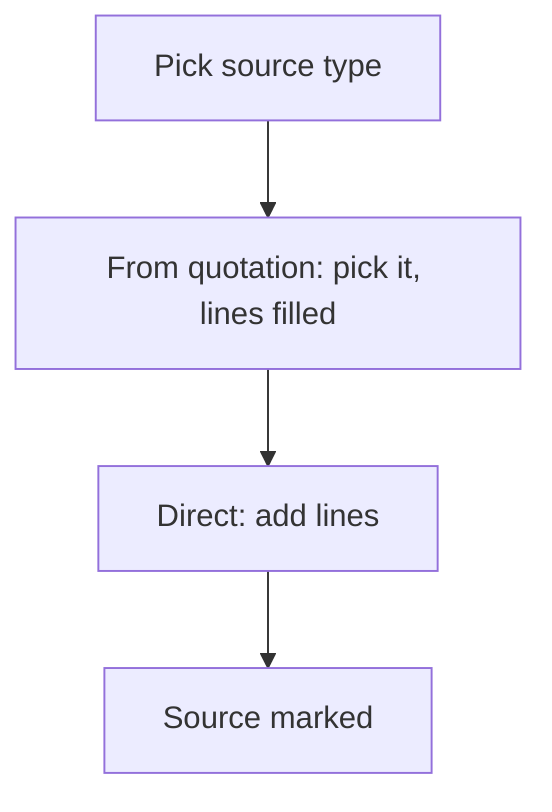

# Order from a quotation or direct

## Task

An order starts from a quotation (or visit, enquiry, lead) or is typed in directly; the source is marked.

## How

- Source pickText (quotation or direct) on the order.
- Ref to the source row; visibility shows the right fields.
- Lines filled from the source by a report ref.
- Workflow on insert-after updates the source (order created flag or status).

## Workaround

No. Direct feature (pickText, ref, branch). The order-created Yes or No flag on the quotation stands in for a link status.

## Limits

- Changes to the quotation after the order do not flow to the order.

## Flowchart

