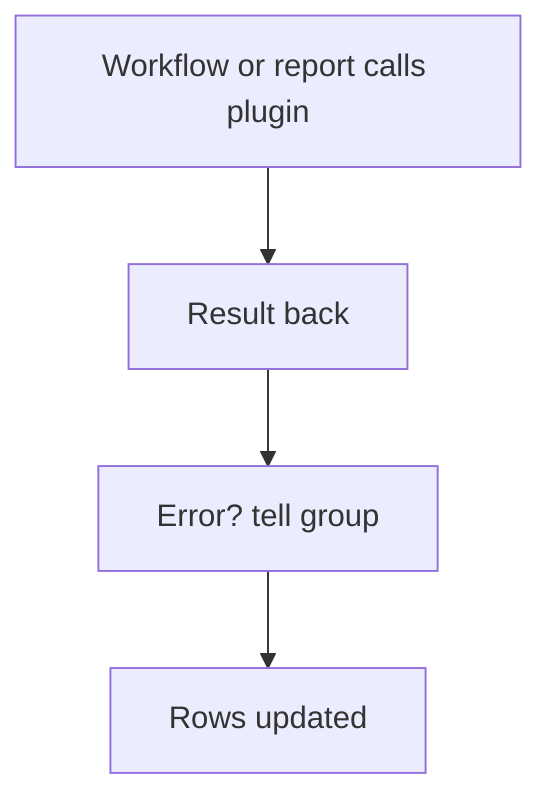

# Outside service by plugin

## Task

Read from or send to an outside service (device data, command, punch logs) and react to the result.

## How

- Plugin with its APIs.
- executePlugin node in a workflow; ERROR branch messages a group.
- Plugin report shows live outside data.
- Scheduled sync: schedule, plugin call, iterate, insert or update rows.

## Workaround

No. Direct feature (plugin node and plugin report). The scheduled sync stands in for a live device feed.

## Limits

- Outside service limits and outages apply; always add an error branch.

## Flowchart

## Execute

Only use this to apply this into a Studio Enterprise via MCP.

Placeholders: <Plugin>, OpsGroup, SyncWf. Needs first: the plugin (import only; `list` to find it).

1. Call: `add kind=node kind=executePlugin plugin=<Plugin> timeoutSeconds terminateKind=stopOrErrorBranch outputParamName=Res` → NEXT: `kind=rowUpdate` or `kind=paramUpdate` with the result.
2. Error: ERROR edge → `kind=sendMessageToGroups toGroups=[OpsGroup] message`.
3. Live view: output form + grid + gridLayout + content formLayout → `add kind=report kind=plugin pluginApi{metaIdPlugin} outputFormMapping` → `action kind=report` → `set kind=group actionPermissionMap`.
4. Sync: `add kind=workflow name=SyncWf` → `kind=eventSchedule scheduler{startDateTime, timeZone, repeatSetting{frequency, repeatFrequencyKind=hours}}` → executePlugin → `kind=branchIterateArray|branchIterateGrid` → rowInsert or rowUpdate (apply PAT-insert-row-in-other-sheet Execute).
5. `set kind=workflow edgeMap`: NEXT, ERROR, ITERATE → `validate` till ok=true.

Gaps: plugin create is import only; executePlugin API pick and input mapping not in schema (verify: describe); plugin report API id unclear.
