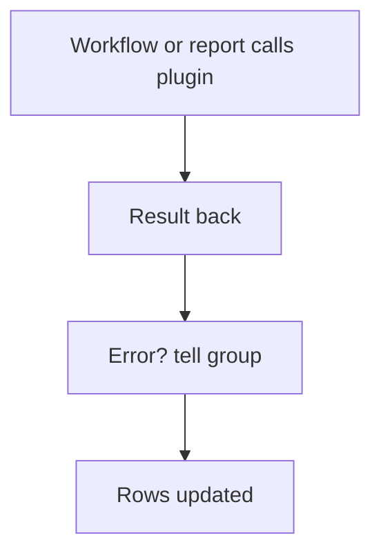

# Outside service by plugin

## Task

Read from or send to an outside service (device data, command, punch logs) and react to the result.

## How

- Plugin with its APIs.
- executePlugin node in a workflow; ERROR branch messages a group.
- Plugin report shows live outside data.
- Scheduled sync: schedule, plugin call, iterate, insert or update rows.

## Workaround

No. Direct feature (plugin node and plugin report). The scheduled sync stands in for a live device feed.

## Limits

- Outside service limits and outages apply; always add an error branch.

## Flowchart

