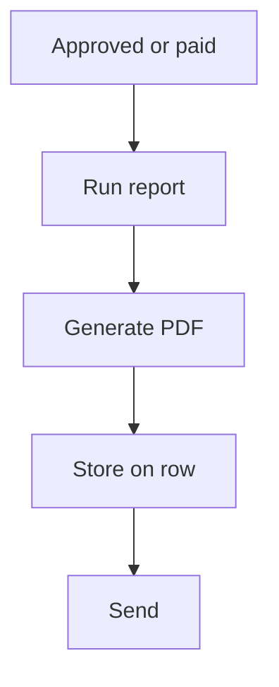

# PDF from a report

## Task

Make a PDF (receipt, quotation, order, payslip, request) and keep or send it.

## How

- Composite report merging a section part and a grid part into an output form.
- Workflow on approval, payment or insert: executeReport, generatePdf.
- Row update stores the PDF in a document field; optional deeplink.
- Send by email, WhatsApp or user message.

## Workaround

No. Direct feature (report plus generatePdf).

## Limits

- Layout follows the output form; fine print layout is limited.
- Regenerate when the source changes, or the PDF goes stale.

## Flowchart

