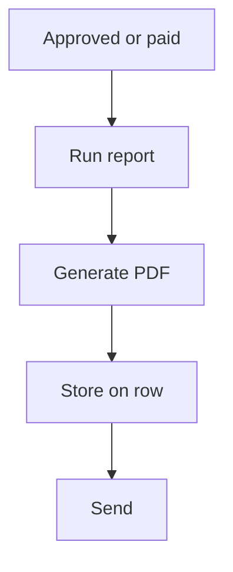

# PDF from a report

## Task

Make a PDF (receipt, quotation, order, payslip, request) and keep or send it.

## How

- Composite report merging a section part and a grid part into an output form.
- Workflow on approval, payment or insert: executeReport, generatePdf.
- Row update stores the PDF in a document field; optional deeplink.
- Send by email, WhatsApp or user message.

## Workaround

No. Direct feature (report plus generatePdf).

## Limits

- Layout follows the output form; fine print layout is limited.
- Regenerate when the source changes, or the PDF goes stale.

## Flowchart

## Execute

Only use this to apply this into a Studio Enterprise via MCP.

Placeholders: DocOut, DocLayout, HeadReport, LinesReport, DocReport, PdfWf. Needs first: source sheet.

1. Output form `DocOut` → `type=section Head` + fields → `type=grid Lines` + fields → `kind=gridLayout kind=table showComps` → `kind=formLayout type=content rootLayout=true name=DocLayout renderingMode=a4Size` (+ `type=template` for header/footer).
2. Part reports: `kind=var kind=mapping` (section) + one with `toGrid=Lines` → `add kind=report kind=spreadsheet` HeadReport, LinesReport → `add kind=report kind=composite name=DocReport mergeReports=[HeadReport, LinesReport] outputForm=DocOut`.
3. Source form: `type=document PdfFile`.
4. Workflow: event (`eventSsUpdateAfter` on approval, `eventPaymentReceipt` or `eventSsInsertAfter`) → `kind=executeReport report=DocReport outputParamName=Doc` → `kind=generatePdf contentLayout=DocLayout outputField{param, field:PdfFile} fileName` → `kind=rowUpdate rowIdPointer option=Mapping` (store PdfFile).
5. Optional: `kind=generateDeeplink`; send by `kind=sendEmail attachmentField`, `kind=sendWhatsappMessage mediaField` or `kind=sendMessageToUsers`.
6. `set kind=workflow edgeMap` (NEXT, ERROR) → `validate` till ok=true.

Gaps: feeding the event row into executeReport not in guide; which param generatePdf renders unverified (describe).
