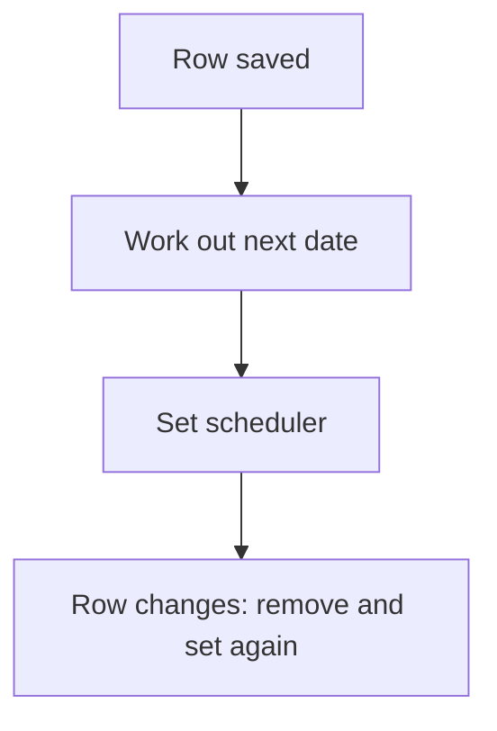

# Per-row scheduler

## Task

Each row gets its own timed job (next deduction, auto cancel, payment reminder), reset when the row changes.

## How

- schedulerId and dateTime fields on the row.
- applyFormula works out the next date.
- executeScheduler sets the job; executeSchedulerRemove clears it on change or remove.

## Workaround

No. Direct feature (scheduler nodes on a row).

## Limits

- Old scheduler must be removed before a new one is set, or jobs double.

## Flowchart

