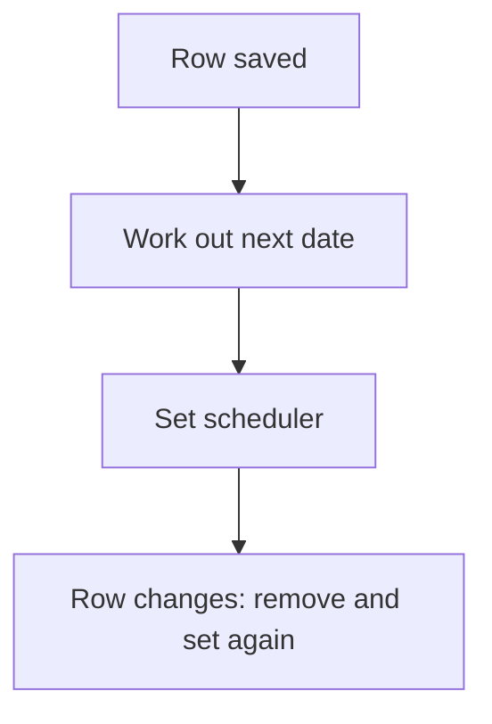

# Per-row scheduler

## Task

Each row gets its own timed job (next deduction, auto cancel, payment reminder), reset when the row changes.

## How

- schedulerId and dateTime fields on the row.
- applyFormula works out the next date.
- executeScheduler sets the job; executeSchedulerRemove clears it on change or remove.

## Workaround

No. Direct feature (scheduler nodes on a row).

## Limits

- Old scheduler must be removed before a new one is set, or jobs double.

## Flowchart

## Execute

Only use this to apply this into a Studio Enterprise via MCP.

Placeholders: Sheet, JobId, NextRunAt, RowJobWf, JobStart. Needs first: Sheet.

1. Fields: `type=schedulerId name=JobId`, `type=dateTime name=NextRunAt`.
2. Workflow: `add kind=workflow name=RowJobWf` (4 maps `{}`).
3. Set path: `kind=eventSsInsertAfter` / `eventSsUpdateAfter spreadsheet=Sheet` → `kind=applyFormula assignToField{param:$Curr, field:NextRunAt} javascriptFormula` → `kind=executeSchedulerRemove forSchedulerIdField{param:$Curr, field:JobId}` (update only) → `kind=executeScheduler scheduleTrigger:<binder on NextRunAt> startNode=JobStart forRemoveSchedulerIdField{param, field:JobId}` (verify: describe) → `kind=rowUpdate` saves JobId, NextRunAt.
4. Job body: nodes from `JobStart` (no edge into it) doing the timed work.
5. Clear path: `kind=eventSsRemoveBefore spreadsheet=Sheet` → `executeSchedulerRemove`.
6. `set kind=workflow edgeMap`: NEXT chains → `validate` till ok=true.

Gaps: where executeScheduler writes the new id unverified (forRemoveSchedulerIdField?); scheduleTrigger binder shape (`schema kind=argBinder`).
