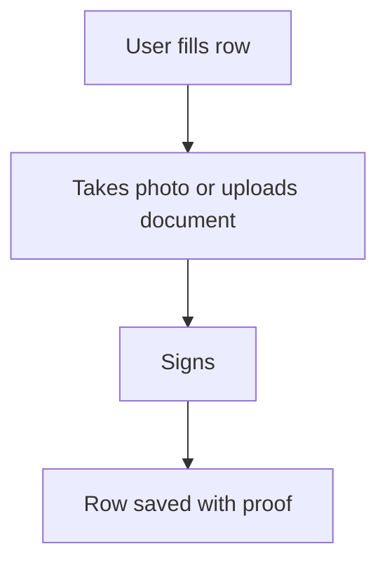

# Photo, document and signature capture

## Task

Attach proof to a row: photos, place, documents, receipts, signature.

## How

- camera, image, document and setOfDocument fields.
- location field for the place.
- signature field, often with approver pickUser fields.

## Workaround

No. Direct feature (capture field types).

## Limits

- Many large photos slow sync on weak networks.

## Flowchart

## Execute

Only use this to apply this into a Studio Enterprise via MCP.

Placeholders: field names below. Needs first: the form and its sheet.

1. Photos: `type=camera SitePhoto allowPickImage mediaCompressionQuality=balanced captureLocation captureTime`; `type=image` for picked photos.
2. Files: `type=document ReceiptDoc fileTypeSet maxSize`; `type=setOfDocument Docs`.
3. Place: `type=location Place captureMode=onInsert`.
4. Sign: `type=pickUser Approver roleIdDataSource=[Role]` → `type=signature ApproverSign captureUser captureTime`; limit by `permissionMatrix` or `disabledRoles`.
5. Add fields to the sheet layout `showComps` / card `item.mediaFields`.
6. `validate` till ok=true.

Gaps: `maxSize` untyped (check variant schema); permissionMatrix shape (`schema kind=permissionMatrix`).
