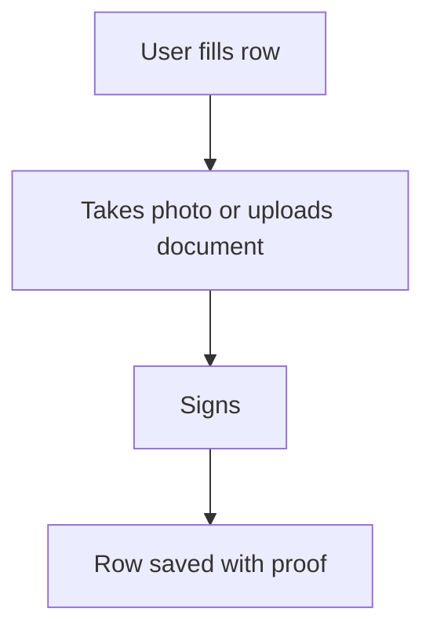

# Photo, document and signature capture

## Task

Attach proof to a row: photos, place, documents, receipts, signature.

## How

- camera, image, document and setOfDocument fields.
- location field for the place.
- signature field, often with approver pickUser fields.

## Workaround

No. Direct feature (capture field types).

## Limits

- Many large photos slow sync on weak networks.

## Flowchart

