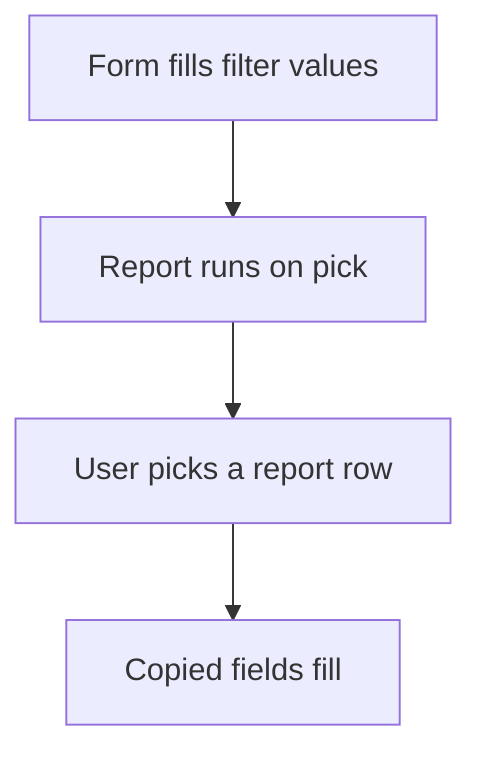

# Pick rows from a report ref

## Task

Fill a field or grid line from live data that a plain ref cannot give (stock per warehouse, ordered and dispatched quantity, balance, shipping address).

## How

- Query report with the form as input (entity input) and an output form.
- refReport field on the form or in a grid column.
- Fields copied from the report pick.

## Workaround

No. Direct feature (refReport).

## Limits

- Values are taken at pick time.
- Each pick needs its own query report.

## Flowchart

