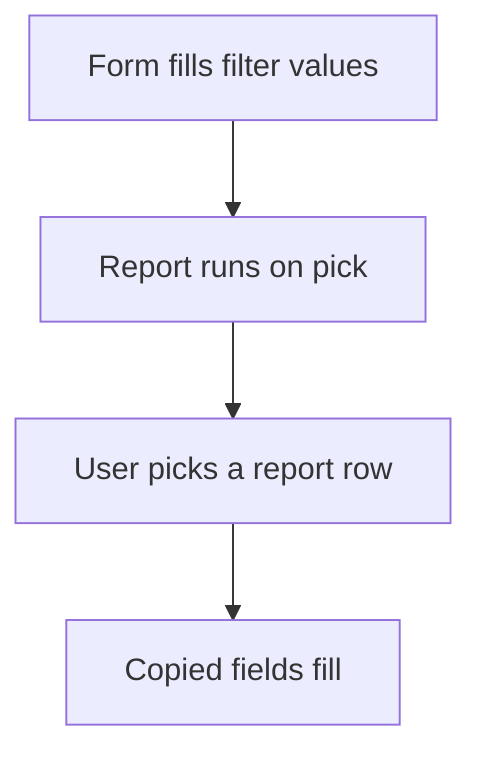

# Pick rows from a report ref

## Task

Fill a field or grid line from live data that a plain ref cannot give (stock per warehouse, ordered and dispatched quantity, balance, shipping address).

## How

- Query report with the form as input (entity input) and an output form.
- refReport field on the form or in a grid column.
- Fields copied from the report pick.

## Workaround

No. Direct feature (refReport).

## Limits

- Values are taken at pick time.
- Each pick needs its own query report.

## Flowchart

## Execute

Only use this to apply this into a Studio Enterprise via MCP.

Placeholders: PickOut, Rows, RowsTable, PickReport. Needs first: source sheets; the calling form.

1. Output form `PickOut` → `type=grid name=Rows` + fields (Warehouse, Item, Balance) → `kind=gridLayout kind=table name=RowsTable showComps=[…]`.
2. Report: `add kind=report kind=query inputForm=<CallingForm> outputForm=PickOut fromSpreadsheets=[…] neoQL{value}` (input binding: verify: describe).
3. Field: `type=refReport report=PickReport grid=Rows layoutGrid=RowsTable copyFieldMap keyFields`; in a grid column add `composite=<Grid>`.
4. Copied fields: `type=decimal` / `type=text` with `disabled=true`.
5. `validate` till ok=true.

Gaps: calling form as report input unverified; NeoQL input syntax; copyFieldMap shape (describe).
