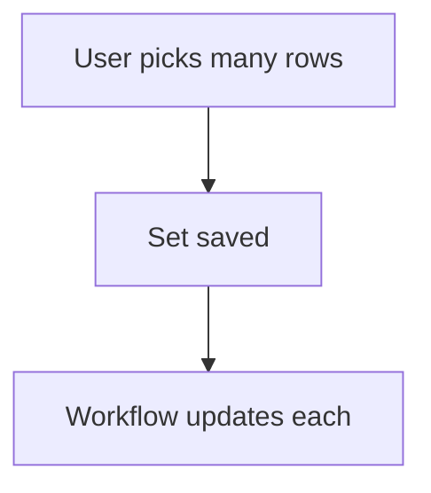

# Pick many rows

## Task

Link one row to several rows of another sheet (approved and rejected units, returned units, customers on a ticket).

## How

- refSet field to the other sheet.
- Workflow iterates the set to update each picked row.
- Fixed variant: a few ref fields, each shown when the one before has a value.

## Workaround

No with refSet. The fixed-ref variant is a stand-in for a multi-pick.

## Limits

- Fixed refs cap the count.

## Flowchart

