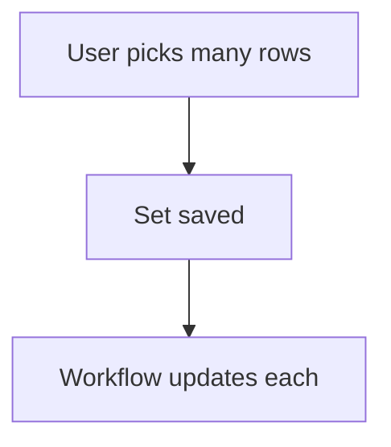

# Pick many rows

## Task

Link one row to several rows of another sheet (approved and rejected units, returned units, customers on a ticket).

## How

- refSet field to the other sheet.
- Workflow iterates the set to update each picked row.
- Fixed variant: a few ref fields, each shown when the one before has a value.

## Workaround

No with refSet. The fixed-ref variant is a stand-in for a multi-pick.

## Limits

- Fixed refs cap the count.

## Flowchart

## Execute

Only use this to apply this into a Studio Enterprise via MCP.

Placeholders: Units, UnitSheet, UnitList, PickWf. Needs first: UnitSheet with list or card layout.

1. Field: `type=refSet name=Units spreadsheet=UnitSheet displayField=UnitNo layoutSpreadsheet=UnitList maxSize`.
2. Workflow: `add kind=workflow name=PickWf` → `kind=eventSsInsertAfter|eventSsUpdateAfter spreadsheet=<Sheet>` → `kind=branchIterateArray arrayField=Units` (verify: describe) → `kind=rowUpdate rowIdPointer{spreadsheet:UnitSheet, row:<$Iter binder>} option=Mapping`.
3. `set kind=workflow edgeMap`: ITERATE → rowUpdate; rowUpdate NEXT → iterate; iterate NEXT → end.
4. Fixed variant: `type=ref` Unit1..UnitN → `formEventCondition HasUnitK statement{lhs:UnitK, operator:hasValue}` → `formEventAction` visible/hidden on UnitK+1 → `formEvent kind=onInitAndOnChange`.
5. `validate` till ok=true.

Gaps: branchIterateArray on a refSet unverified; $Iter row binder shape.
