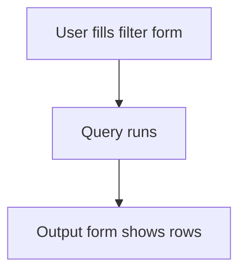

# Query report with filter form

## Task

List or count rows for a date range, user, zone or status (open items, gap checks, counts, history, planning).

## How

- Filter form as report input: dates, pickUser, ref to zone or employee with copied text and rowId.
- Query report over one or more sheets.
- Output form with the result fields.
- Report action per role.

## Workaround

No. Direct feature (query report with filter and output forms).

## Limits

- Each new view is a new report; reuse output forms where you can.

## Flowchart

## Execute

Only use this to apply this into a Studio Enterprise via MCP.

Placeholders: FilterForm, OutForm, OutGrid, OutTable, OutContent, ListReport, ListReportAction, Role. Needs first: source sheets, filter fields in their `queryables`.

1. Filter form: `add kind=form name=FilterForm` → `kind=composite type=section` → fields (`type=date` / `type=dateRange`, `type=pickUser roleIdDataSource=[Role]`, `type=ref spreadsheet=ZoneSheet layoutSpreadsheet=<list|card> copyFieldMap` for text + rowId (verify: describe)).
2. Output form: `add kind=form name=OutForm` → `kind=composite type=grid name=OutGrid` → result fields → `add kind=gridLayout kind=table showComps=[…]` → `add kind=formLayout type=content rootLayout=true direction=vertical` with `flexCenter.gridLayouts=[OutTable]`.
3. Report: `schema kind=report variant=query` → `add kind=report kind=query inputForm=FilterForm outputForm=OutForm fromSpreadsheets=[…] neoQL={value:"…"}`.
4. Action: `add kind=action kind=report name=ListReportAction report=ListReport outputFormContentLayout=OutContent`.
5. `set kind=group actionPermissionMap={"ListReportAction":{"roles":[Role]}}`, one action per role that needs it.
6. `validate` till ok=true. `describe kind=report` to confirm.

Gaps: neoQL syntax for filter inputs and output columns not in guide (verify: describe an existing query report). copyFieldMap shape unconfirmed.
