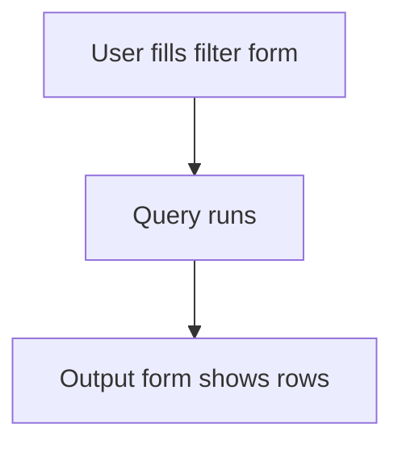

# Query report with filter form

## Task

List or count rows for a date range, user, zone or status (open items, gap checks, counts, history, planning).

## How

- Filter form as report input: dates, pickUser, ref to zone or employee with copied text and rowId.
- Query report over one or more sheets.
- Output form with the result fields.
- Report action per role.

## Workaround

No. Direct feature (query report with filter and output forms).

## Limits

- Each new view is a new report; reuse output forms where you can.

## Flowchart

