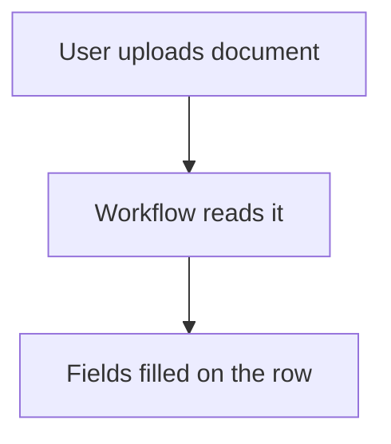

# Read a document into a form

## Task

Fill form fields from an uploaded document (customer details, lead list).

## How

- Document field on the sheet.
- Workflow on insert-after: branch when the document has a value.
- aiDocumentToForm, then row update or row insert with the read fields.

## Workaround

No. Direct feature (document to form node).

## Limits

- Read values need a human check.

## Flowchart

