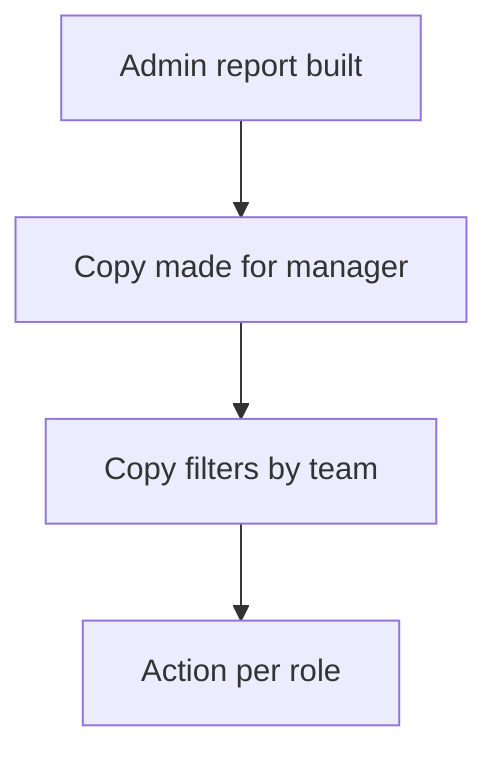

# Role copy of a report

## Task

Managers see the same report as admins, but only for their team.

## How

- Copy of the report and its parts per role, often with a role suffix.
- Same output form; the copy filters by the caller's team.
- Separate report action per role.

## Workaround

Yes. No row scope by role on a report; a copy per role stands in.

## Limits

- Every change must be made in each copy.

## Flowchart

## Execute

Only use this to apply this into a Studio Enterprise via MCP.

Placeholders: AdminReport, ManagerReport, OutForm, OutContent, TeamCond, AdminRole, ManagerRole. Needs first: apply PAT-query-report-with-filter Execute (admin report).

1. Team filter: query report → team clause on caller in `neoQL.value`; spreadsheet report → `add kind=var kind=condition name=TeamCond value={node,sourceForm}` (verify: describe).
2. Copy: `add kind=report name=ManagerReport` with same `kind`, `inputForm`, `outputForm`, `outputFormMapping` as AdminReport, plus team clause or `filterCondition={cond:TeamCond,negation:false}`.
3. Action: `add kind=action kind=report name=ManagerReportAction report=ManagerReport outputFormContentLayout=OutContent`.
4. `set kind=group actionPermissionMap`: AdminReportAction `roles=[AdminRole]`, ManagerReportAction `roles=[ManagerRole]`.
5. `validate` till ok=true. `describe` both reports to check they match.

Gaps: "caller's team" shape unknown (context binder `{kind:caller,…}`, verify: `schema kind=argBinder`). No way to link copies; each change done twice.
