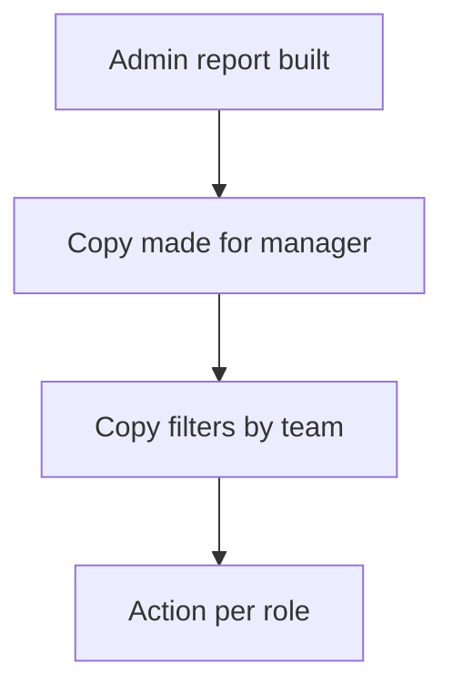

# Role copy of a report

## Task

Managers see the same report as admins, but only for their team.

## How

- Copy of the report and its parts per role, often with a role suffix.
- Same output form; the copy filters by the caller's team.
- Separate report action per role.

## Workaround

Yes. No row scope by role on a report; a copy per role stands in.

## Limits

- Every change must be made in each copy.

## Flowchart

