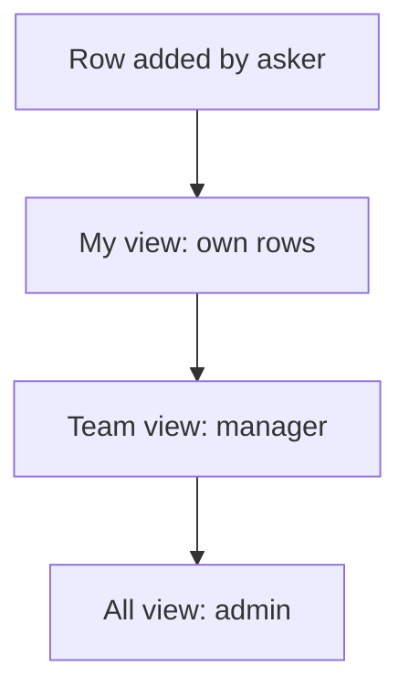

# Role views of one sheet

## Task

Each role sees its own slice of one sheet: my rows, assigned to me, my team, pending, all.

## How

- rowInsert action to add, for the asking roles.
- Several spreadsheetEditor actions on the same sheet, one per view and role.
- Assign variant: pickUser limited to a role plus an assigned-to-me view.
- Outside role can get its own action on a sheet.

## Workaround

No. Direct feature (one action per view).

## Limits

- Many actions on one sheet crowd the menu.
- Read rights still decide what each role can open.

## Flowchart

