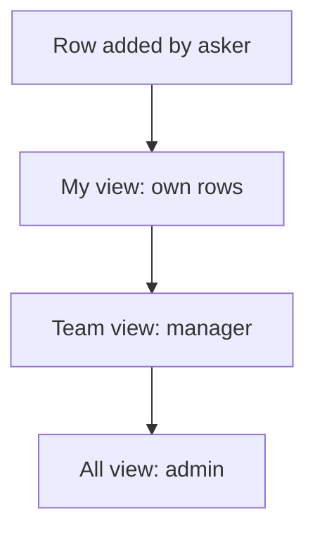

# Role views of one sheet

## Task

Each role sees its own slice of one sheet: my rows, assigned to me, my team, pending, all.

## How

- rowInsert action to add, for the asking roles.
- Several spreadsheetEditor actions on the same sheet, one per view and role.
- Assign variant: pickUser limited to a role plus an assigned-to-me view.
- Outside role can get its own action on a sheet.

## Workaround

No. Direct feature (one action per view).

## Limits

- Many actions on one sheet crowd the menu.
- Read rights still decide what each role can open.

## Flowchart

## Execute

Only use this to apply this into a Studio Enterprise via MCP.

Placeholders: Sheet, Form, AssignedTo, MyTable, TeamTable, AllTable, MineCond, AssignedCond, roles. Needs first: Sheet and its form.

1. Assign variant: `add kind=field parent=Form type=pickUser name=AssignedTo roleIdDataSource=[Role]`. `set kind=spreadsheet queryables=[AssignedTo,…]`.
2. Layouts: `add kind=spreadsheetLayout parent=Sheet kind=table showComps=[…]` per view; unique names (MyTable, TeamTable, AllTable).
3. Filters: `add kind=var kind=condition` per view (MineCond: created by caller; AssignedCond: AssignedTo is caller; pending: status equalTo key) (verify: describe for `value.node`).
4. Add: `add kind=action kind=rowInsert spreadsheet=Sheet`.
5. Views: `add kind=action kind=spreadsheetEditor spreadsheet=Sheet layoutSpreadsheet=<view> filterCondition={cond:<Cond>,negation:false}` per view; All view no filter.
6. `set kind=group actionPermissionMap` per action with its `roles`; outside role gets its action in its own group.
7. `set kind=spreadsheet insertRoles/updateRoles/removeRoles` to match who may write.
8. `validate` till ok=true.

Gaps: condition on caller / caller's team (context binder) unconfirmed (verify: `schema kind=argBinder`).
