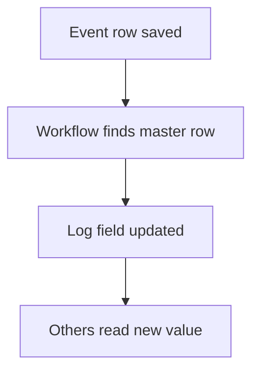

# Running total in a log number field

## Task

Keep a balance or count (rent, leave, stock, credit, cash, visits) that many other rows change over time.

## How

- logDecimal or logNumber field on the master row.
- Workflows add or subtract with rowUpdateFieldLogNumber.
- Other rows copy the current value through a ref.

## Workaround

No. Direct feature (log number fields). Some Builds note it as a stand-in for a full ledger.

## Limits

- No floor: a balance can go below zero unless a branch resets it.
- The log is per field; reports on movements need their own transaction sheet.

## Flowchart

## Execute

Only use this to apply this into a Studio Enterprise via MCP.

Placeholders: MasterSheet, MasterForm, Balance, EventSheet, EventForm, Amount, MasterRef, MasterRowId, BalanceWf. Needs first: MasterSheet with a list|card layout, EventSheet.

1. Master: `add kind=field parent=MasterForm type=logDecimal name=Balance` (or `logNumber`), `logReadRoles=[…]`.
2. Event form: `add kind=field parent=EventForm type=ref name=MasterRef spreadsheet=MasterSheet layoutSpreadsheet=<list> copyFieldMap` copying rowId into MasterRowId and current Balance (verify: describe).
3. Workflow: `add kind=workflow name=BalanceWf` (4 maps `{}`).
4. Nodes: `add kind=node kind=eventSsInsertAfter spreadsheet=EventSheet` → `add kind=node kind=rowUpdateFieldLogNumber rowIdPointer={spreadsheet:MasterSheet,row:<B field $Curr MasterRowId>} outputLogNumberField=Balance operation=add|subtract inputField=<B field $Curr Amount> operationMessage={value:"…"}`.
5. `set kind=workflow edgeMap`: event → update NEXT.
6. `validate` till ok=true.

Gaps: field binder `value` shape (verify: `schema kind=argBinder`). edgeMap entry keys unverified (wire 1, describe, mirror). No floor on balance.
