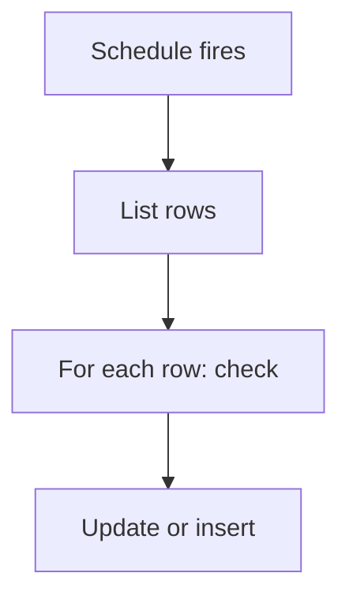

# Scheduled job over rows

## Task

Run a job each day, week, month or year over many rows (deduct rent, close the day, credit leave, count down credit days).

## How

- eventSchedule with the time and repeat.
- Query, report or branchIterateSpreadsheet to list rows.
- Per row: branch, row update, log number update or row insert.
- Optional error message to a developer group.

## Workaround

No. Direct feature (schedule and iterate nodes).

## Limits

- One run touches many rows; failures half way need a gap check report.
- Time zone and partition limits apply to big sheets.

## Flowchart

## Execute

Only use this to apply this into a Studio Enterprise via MCP.

Placeholders: JobWf, Sheet, DevGroup. Needs first: Sheet, fields used in filter in its `queryables`.

1. Workflow: `add kind=workflow name=JobWf` (4 maps `{}`).
2. Schedule: `add kind=node kind=eventSchedule scheduler={startDateTime, timeZone, repeatSetting:{frequency:1, repeatFrequencyKind:days|weeks|months|years}}` (dates ISO UTC of ent-local time).
3. List: `add kind=node kind=branchIterateSpreadsheet spreadsheet=Sheet filterCondition=…` (or `ssExecuteQuery` / `executeReport` + `branchIterateGrid`).
4. Per row: `branchIfElse option=Condition condition={statement:{lhs,operator,rhs}}` → `rowUpdate rowIdPointer={spreadsheet:Sheet,row:<B $Iter row>} option=Mapping outputMapping=…`, or `rowUpdateFieldLogNumber`, or `paramCreate` → `rowInsert`.
5. Optional: `sendMessageToGroups toGroups=[DevGroup] message={value:"…"}` on the update node's ERROR edge (`terminateKind=resume`).
6. `set kind=workflow edgeMap`: schedule → iterate NEXT; iterate → branch ITERATE; branch → update TRUE; update → iterate NEXT (loop); update → message ERROR.
7. `validate` till ok=true.

Gaps: `filterCondition` / `condition` untyped; `$Iter` row binder shape (verify: describe). edgeMap entry keys unverified.
