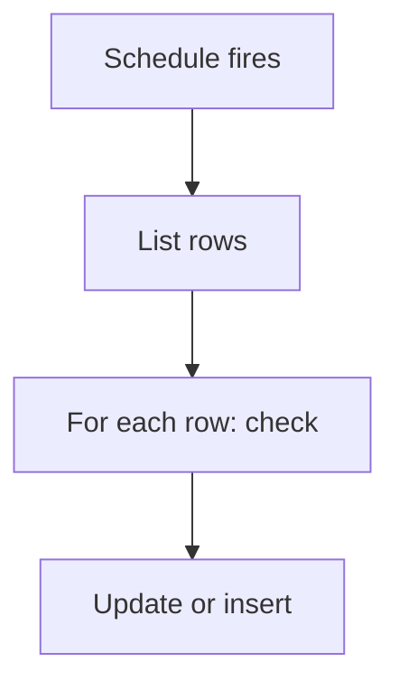

# Scheduled job over rows

## Task

Run a job each day, week, month or year over many rows (deduct rent, close the day, credit leave, count down credit days).

## How

- eventSchedule with the time and repeat.
- Query, report or branchIterateSpreadsheet to list rows.
- Per row: branch, row update, log number update or row insert.
- Optional error message to a developer group.

## Workaround

No. Direct feature (schedule and iterate nodes).

## Limits

- One run touches many rows; failures half way need a gap check report.
- Time zone and partition limits apply to big sheets.

## Flowchart

