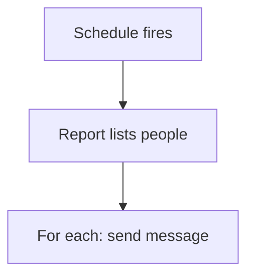

# Scheduled reminder message

## Task

Send reminders or summaries at set times (missing punch, open orders, daily summary, check message).

## How

- eventSchedule at fixed times.
- Report or query lists who to remind; iterate the grid.
- Push, user, WhatsApp template or group message per row.
- Summary variant: run a report and forward a trigger row.

## Workaround

No. Direct feature (schedule plus message nodes).

## Limits

- Message templates must be approved for WhatsApp.
- No snooze or opt-out unless built.

## Flowchart

## Execute

Only use this to apply this into a Studio Enterprise via MCP.

Placeholders: RemindWf, RemindForm, RemindGrid, TemplateGroup, TriggerSheet. Needs first: sheets to scan; for the summary variant, apply PAT-trigger-row-for-workflow Execute.

1. Output form: `add kind=form name=RemindForm` → `kind=composite type=grid name=RemindGrid` → `type=pickUser` user field + message fields.
2. Workflow: `add kind=workflow name=RemindWf` (4 maps `{}`) → `add kind=node kind=eventSchedule scheduler={startDateTime, timeZone, repeatSetting:{frequency:1, repeatFrequencyKind:days}}`.
3. List: `add kind=node kind=ssExecuteQuery outputForm=RemindForm spreadsheets=[…] neoQL={value:"…"} outputParamName=Remind` (or `executeReport report=…`).
4. Loop: `add kind=node kind=branchIterateGrid grid=RemindGrid`.
5. Send per row: `sendPushNotification toUsers=…`, `sendMessageToUsers message={value:"…"} toUsers=…`, or `sendWhatsappTemplate toUsers=… templateGroup=TemplateGroup templateVarMap.map=…`.
6. Summary variant: `executeReport report=…` → `paramCreate` → `rowInsert spreadsheet=TriggerSheet` (or `rowForward toGroups=[…]`).
7. `set kind=workflow edgeMap`: schedule → query NEXT; query → iterate NEXT; iterate → send ITERATE; send → iterate NEXT.
8. `validate` till ok=true.

Gaps: WhatsApp template approval is outside MCP. `toUsers` from `$Iter` user field shape (verify: describe). edgeMap entry keys unverified.
