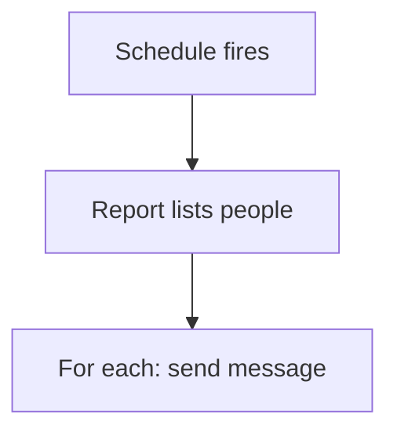

# Scheduled reminder message

## Task

Send reminders or summaries at set times (missing punch, open orders, daily summary, check message).

## How

- eventSchedule at fixed times.
- Report or query lists who to remind; iterate the grid.
- Push, user, WhatsApp template or group message per row.
- Summary variant: run a report and forward a trigger row.

## Workaround

No. Direct feature (schedule plus message nodes).

## Limits

- Message templates must be approved for WhatsApp.
- No snooze or opt-out unless built.

## Flowchart

