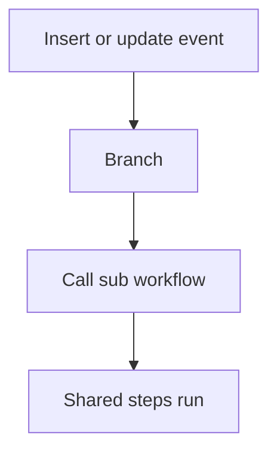

# Shared sub workflow

## Task

Steps used from several events (insert and update, approve) live in one sub workflow.

## How

- eventSubWorkflow with the shared steps.
- executeSubWorkflow from each calling branch.

## Workaround

No. Direct feature (sub workflows).

## Limits

- Inputs must be passed the same way from every caller.

## Flowchart

