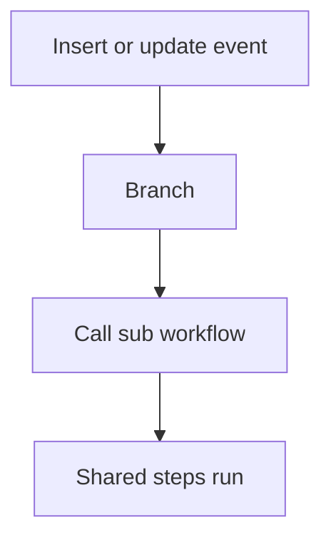

# Shared sub workflow

## Task

Steps used from several events (insert and update, approve) live in one sub workflow.

## How

- eventSubWorkflow with the shared steps.
- executeSubWorkflow from each calling branch.

## Workaround

No. Direct feature (sub workflows).

## Limits

- Inputs must be passed the same way from every caller.

## Flowchart

## Execute

Only use this to apply this into a Studio Enterprise via MCP.

Placeholders: SharedWf, SubStart, SubInForm, caller workflows. Needs first: caller workflows.

1. Input form (if values are passed): `add kind=form name=SubInForm` → `kind=composite type=section` → fields passed in.
2. Shared steps: `add kind=workflow name=SharedWf` (4 maps `{}`) → `add kind=node kind=eventSubWorkflow name=SubStart inputForm={form:SubInForm} sharedParameters=[…]` → shared step nodes.
3. `set kind=workflow ref=SharedWf edgeMap`: SubStart → steps NEXT.
4. Each caller: `add kind=node kind=executeSubWorkflow startNode=SubStart sharedParamMap=…` in the calling branch; wire it NEXT in that caller's edgeMap. No edge into SubStart.
5. `validate` till ok=true.

Gaps: `startNode` across workflows vs same workflow unconfirmed; `sharedParamMap` / `sharedParameters` entry shape unknown (verify: describe).
